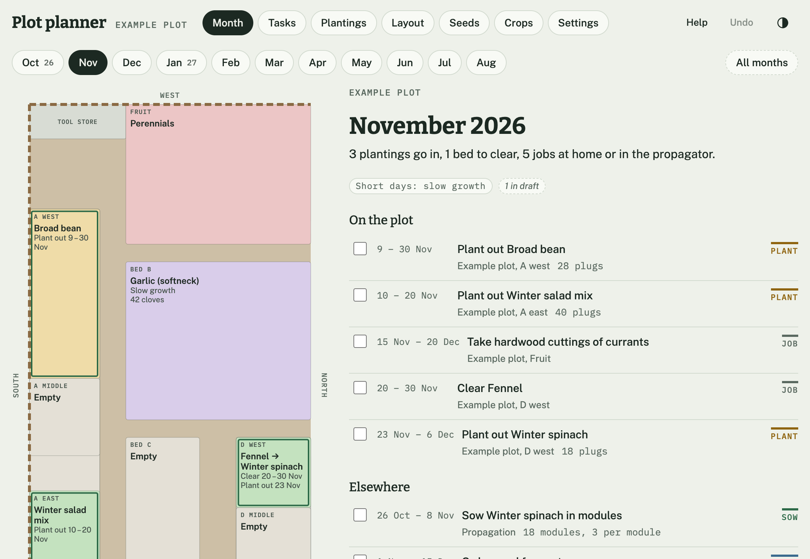

# Plot planner

**Plan an allotment, garden or growing space month by month: free, open source, offline, and no sign-up.**



Draw your plot to scale, say what you'll grow where, and the planner works out when to sow, pot on, harden off, plant out and harvest, from your own frost dates. It works in either hemisphere, for allotments, back gardens, raised beds, polytunnels, containers and small market gardens.

- **Month by month.** Each month shows your plan to scale, coloured by what's growing, with that month's jobs beside it. Or see every month at once.
- **Location-aware.** Crop timings are stored relative to your last and first frosts, so the same library works anywhere. Polytunnels and cold frames shift the season for tender crops.
- **Drafts.** Try ideas, or open a plan someone shares with you, without touching your agreed plan.
- **Checks.** Overcrowded beds, overlapping crops, rotation, crops that won't fit your season, plants left too long in modules, and runs past the end of a tenancy.
- **Tasks.** Generated from your plantings, plus your own jobs. Export them to any calendar app.
- **Seeds.** An inventory with viability warnings, and import from the spreadsheet you already keep.
- **In your language.** English and French so far; adding a language is one file.
- **Yours.** No accounts, no tracking, no third-party requests. Data stays in your browser. Back it up as one JSON file.

It's a static site: there's nothing to run and nothing to pay for. Host it on any static host, or use it from a downloaded copy.

**Hosted copy:** [plot.tomlo.ng](https://plot.tomlo.ng) (access is currently limited). Fork the repository to host your own in a few minutes; see [Self-hosting](docs/developer-guide.md#self-hosting).

## Guides

- [User guide](docs/user-guide.md): getting started, backing up, sharing
- [Developer guide](docs/developer-guide.md): architecture, running locally, self-hosting
- [Data schema](docs/data-schema.md): the backup file format, for anyone building tools that read or write it
- [Contributing](CONTRIBUTING.md): including how to add or correct a crop, no coding needed

## Quick start for developers

```sh
npm install
npm run dev      # http://localhost:5173
npm test         # unit tests
npm run build    # validates the crop library, then builds to dist/
```

Requires Node 20 or later.

## Licences

- Code: [MIT](LICENSE)
- Crop library (`crops/`): [CC0 1.0](crops/LICENSE.md), public domain
- Fonts: Bitter, Public Sans and IBM Plex Mono under the [SIL Open Font License](public/licenses/), bundled so the app makes no third-party requests
